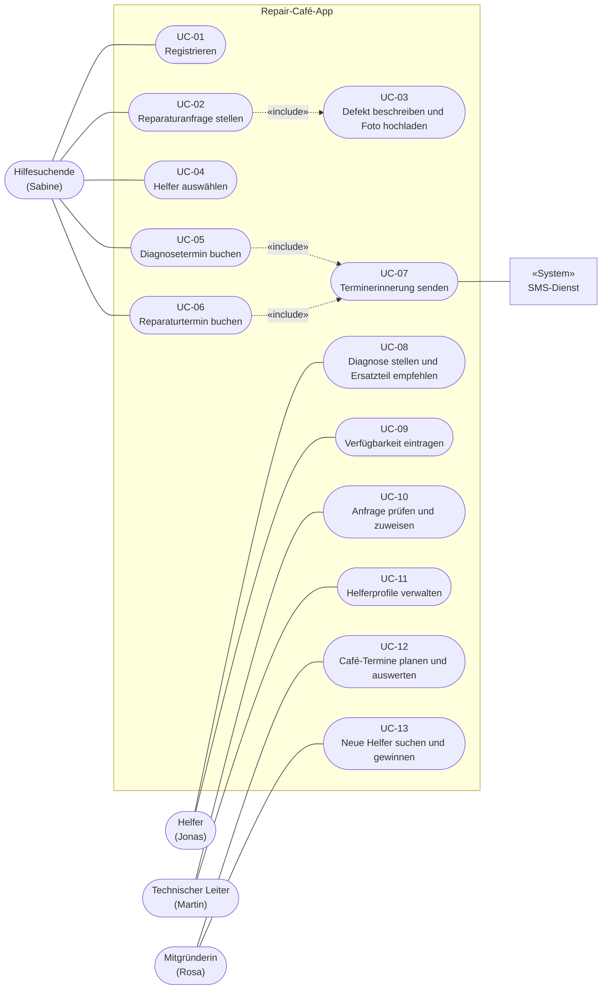

# Anwendungsfalldiagramm und Anwendungsfall – Repair-Café-App

## Anwendungsfalldiagramm

**Systemgrenze:** Repair-Café-App. Gestrichelte Pfeile zeigen «include». Fokus auf die 13 wichtigsten Anwendungsfälle, eindeutig nummeriert von UC-01 bis UC-13.

### Akteure

| Akteur | Persona | Beteiligte Anwendungsfälle |
|---|---|---|
| Hilfesuchende | Sabine | UC-01, UC-02, UC-04, UC-05, UC-06 |
| Helfer | Jonas | UC-08, UC-09 |
| Technischer Leiter | Martin | UC-10, UC-11 |
| Mitgründerin | Rosa | UC-12, UC-13 |
| «System» SMS-Dienst | – | UC-07 |

### Anwendungsfälle

| ID | Anwendungsfall | Akteur | Beziehung |
|---|---|---|---|
| UC-01 | Registrieren | Hilfesuchende | |
| UC-02 | Reparaturanfrage stellen | Hilfesuchende | «include» UC-03 |
| UC-03 | Defekt beschreiben und Foto hochladen | | wird von UC-02 eingebunden |
| UC-04 | Helfer auswählen | Hilfesuchende | |
| UC-05 | Diagnosetermin buchen | Hilfesuchende | «include» UC-07 |
| UC-06 | Reparaturtermin buchen | Hilfesuchende | «include» UC-07 |
| UC-07 | Terminerinnerung senden | SMS-Dienst | wird von UC-05 und UC-06 eingebunden |
| UC-08 | Diagnose stellen und Ersatzteil empfehlen | Helfer | |
| UC-09 | Verfügbarkeit eintragen | Helfer | |
| UC-10 | Anfrage prüfen und zuweisen | Technischer Leiter | |
| UC-11 | Helferprofile verwalten | Technischer Leiter | |
| UC-12 | Café-Termine planen und auswerten | Mitgründerin | |
| UC-13 | Neue Helfer suchen und gewinnen | Mitgründerin | |

---

## Strukturierter Anwendungsfall: Diagnose- und Reparaturtermin buchen

Abgeleitet aus dem Szenario „Sabines Kaffeemaschine bekommt ein zweites Leben".

| Feld | Inhalt |
|---|---|
| **Anwendungsfall-Name** | UC-02 Reparaturanfrage stellen, Diagnose- und Reparaturtermin buchen |
| **Akteure** | Primär: Hilfesuchende (Sabine). Sekundär: Helfer (Jonas), SMS-Dienst |
| **Ziel** | Das Gerät ist diagnostiziert, die Hilfesuchende hat die Ersatzteile selbst gekauft und einen bestätigten Reparaturtermin. |
| **Vorbedingungen** | App ist installiert, Nutzerin ist registriert und angemeldet. Mindestens ein Helfer mit freiem Zeitfenster ist im Umkreis verfügbar. |
| **Nachbedingung** | Anfrage, Diagnose mit Ersatzteilempfehlung und beide Termine sind gespeichert, der Helfer ist informiert, Erinnerungen sind geplant. |

### Hauptablauf

1. Nutzerin wählt „Gerät reparieren lassen".
2. System fragt die Gerätekategorie ab, Nutzerin wählt „Küchengerät" und „Kaffeemaschine".
3. System zeigt typische Fehlerbilder, Nutzerin wählt passende Probleme aus.
4. System fordert ein Foto vom Typenschild an, Nutzerin lädt es hoch.
5. System schlägt passende Helfer mit Bewertungen vor, Nutzerin wählt einen aus.
6. Nutzerin bucht einen Diagnosetermin.
7. Beim Diagnosetermin prüft der Helfer das Gerät und erfasst die Diagnose sowie eine Empfehlung für das benötigte Ersatzteil, optional mit Richtpreis.
8. System schickt der Nutzerin die Ersatzteilempfehlung.
9. Nutzerin kauft das Ersatzteil selbst und markiert „Ersatzteil vorhanden".
10. System bietet freie Reparaturtermine beim selben Helfer an.
11. Nutzerin bucht den Reparaturtermin.
12. System speichert den Termin, benachrichtigt den Helfer und plant eine SMS-Erinnerung.

### Alternativer Ablauf

- **4a.** Kein Typenschild auffindbar: Nutzerin überspringt das Foto und beschreibt das Gerät frei.
- **7a.** Kein Ersatzteil nötig: Der Helfer repariert direkt beim Diagnosetermin, Schritte 8 bis 12 entfallen.

### Ausnahmen

- **5e.** Kein passender Helfer verfügbar: Anfrage kommt auf eine Warteliste, der technische Leiter wird informiert.
- **7e.** Reparatur lohnt sich nicht: Helfer vermerkt das, System schlägt Recycling oder Entsorgung vor.
- **9e.** Ersatzteil nicht erhältlich: Nutzerin meldet das, Helfer schlägt eine Alternative vor.

### Beteiligte Systeme

Repair-Café-App (Mobil-App), Backend mit Datenbank für Anfragen, Helfer und Termine, SMS-Dienst für Erinnerungen, Kartendienst für die Umkreissuche, Bildspeicher für Fotos.
